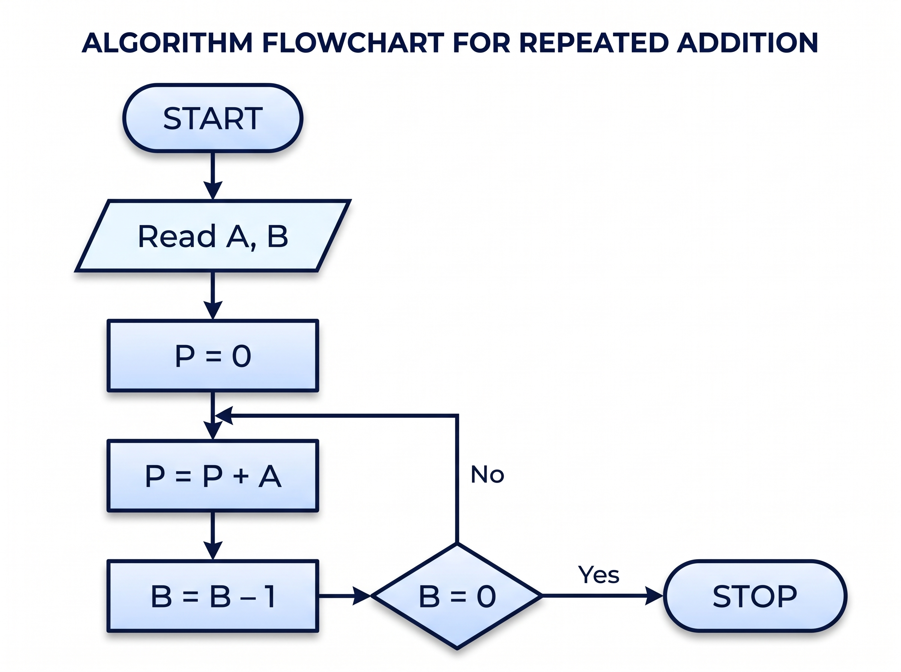
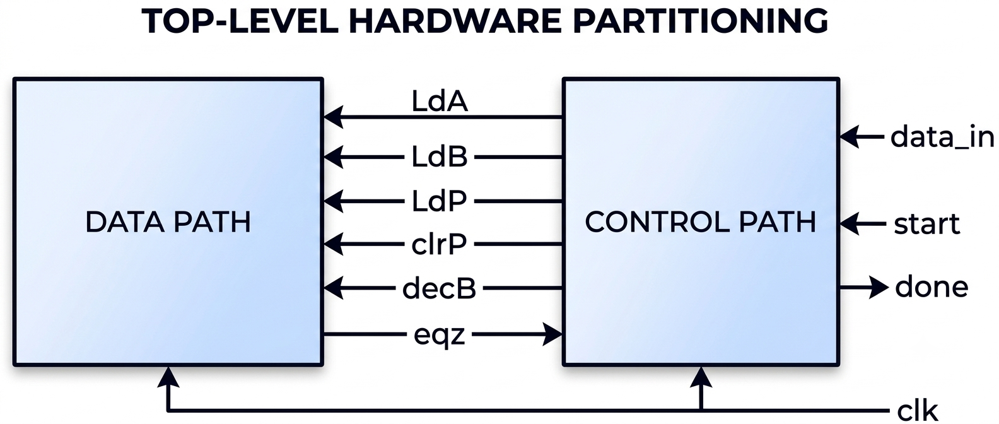
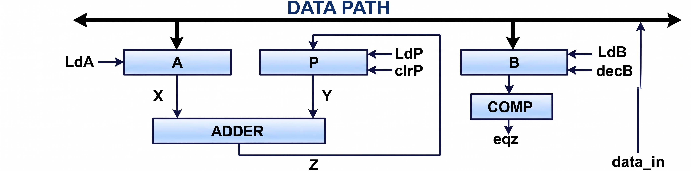
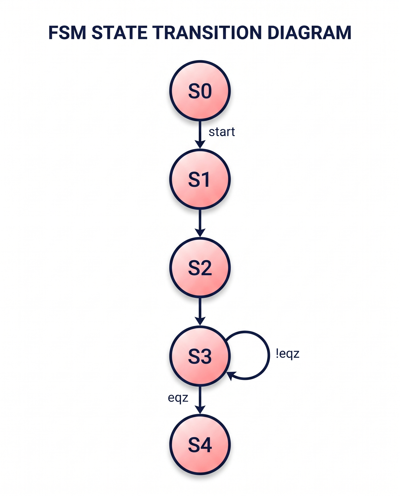
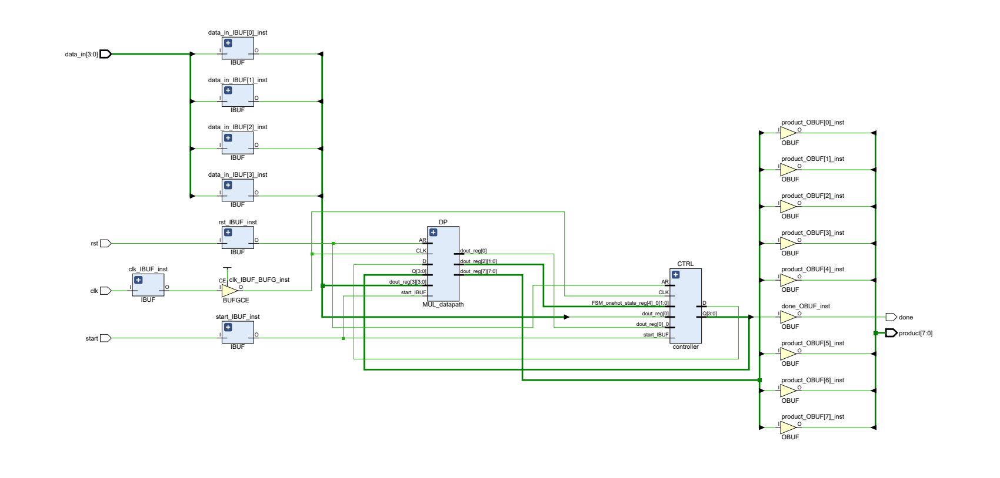
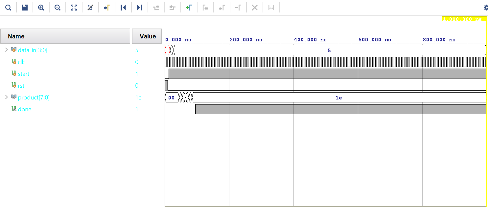
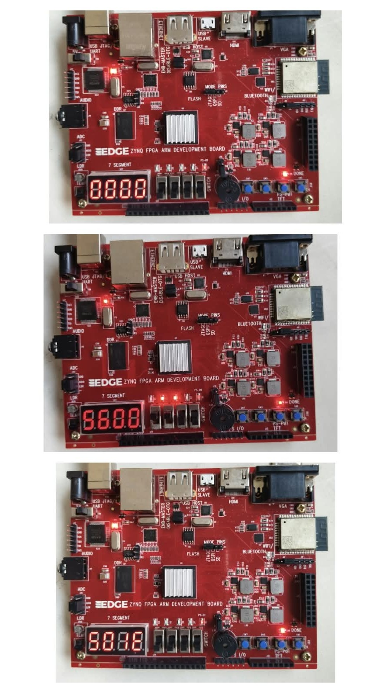

# Hardware Implementation of Multiplication Through Repeated Addition

An RTL architecture and FPGA deployment of a synchronous, cycle-accurate **4-bit unsigned multiplier** using the **repeated-addition algorithm**. The system is partitioned into a decoupled **Datapath** and a synchronous **Finite State Machine (FSM) Controller**, targeted and verified on the **EDGE ZYNQ SoC FPGA Development Board** (AMD Xilinx Zynq-7000 series, `xc7z010clg400-1`).

The hardware implementation features single-step push-button pulse execution, a hardware debouncing engine, live slide-switch monitoring via LEDs, and dynamic 1 kHz multiplexing across an onboard 4-digit common-anode 7-segment display.

## Table of Contents

* [Project Overview](#project-overview)

* [Mathematical Principle & Algorithm](#mathematical-principle--algorithm)

  * [Algorithm Flowchart](#algorithm-flowchart)

* [Hardware Architecture & Microarchitecture](#hardware-architecture--microarchitecture)

  * [Top-Level Architectural Partitioning](#top-level-architectural-partitioning)

  * [Datapath Microarchitecture](#datapath-microarchitecture)

  * [Finite State Machine Controller](#finite-state-machine-controller)

* [Directory Structure](#directory-structure)

* [FPGA Constraints & Board Pinout](#fpga-constraints--board-pinout)

* [Verification & Simulation Results](#verification--simulation-results)

  * [RTL Schematic](#rtl-schematic)

  * [Functional Waveform (Vivado Simulator)](#functional-waveform-vivado-simulator)

* [Physical Implementation & On-Board Testing](#physical-implementation--on-board-testing)

  * [7-Segment Display Organization](#7-segment-display-organization)

  * [Hardware Stepping Sequence ($6 \times 5 = 30 = \text{0x1E}$)](#hardware-stepping-sequence-6-times-5--30--text0x1e)

  * [Live Hardware Verification Output](#live-hardware-verification-output)

* [Synthesis, Implementation & Programming Guide](#synthesis-implementation--programming-guide)

* [Documentation & References](#documentation--references)

## Project Overview

In digital arithmetic, multiplication is fundamentally an iterative sequence of additions. While modern high-speed DSPs use Booth's multiplication or Wallace tree compressors, the **Repeated Addition Multiplier** is an essential architectural baseline for hardware design. It demonstrates:

* Synchronous handshaking between a **Control Unit (FSM)** and an execution **Datapath**.

* Dynamic register management using load enables, clears, and decrement operations.

* Real-world FPGA constraints, clock routing overrides, hardware switch debouncing, and digit-multiplexed display drivers.

## Mathematical Principle & Algorithm

For two 4-bit unsigned binary integers, Multiplicand $A \in [0, 15]$ and Multiplier $B \in [0, 15]$, their product $P$ can span up to 8 bits:

$$
P = A \times B = \sum_{k=1}^{B} A
$$

The multiplier clears an 8-bit accumulator ($P = 0$) and repeatedly adds $A$ to $P$ while decrementing $B$ by 1 on each step until $B = 0$.

### Algorithm Flowchart



## Hardware Architecture & Microarchitecture

### Top-Level Architectural Partitioning

The system isolates the control sequencing logic from arithmetic units, connected by control vectors (`LdA`, `LdB`, `LdP`, `clrP`, `decB`) and condition flags (`eqz`):



### Datapath Microarchitecture

The datapath performs parallel transfers, addition, down-counting, and zero detection:



* **Multiplicand Register A (`PIPO1`):** 4-bit Parallel-In Parallel-Out register with clock enable (`LdA`) and asynchronous reset (`rst`).

* **Multiplier Counter B (`CNTR`):** 4-bit synchronous down-counter. Loads $B$ on `LdB` and decrements on `decB` when $B \ne 0$.

* **Product Accumulator P (`PIPO2`):** 8-bit accumulator with synchronous clear (`clrP`) and parallel load (`LdP`).

* **Adder Core (`ADD`):** Purely combinational 8-bit unsigned adder calculating $Z = P + \{4'b0000, A\}$.

* **Zero Comparator (`EQZ`):** Combinational comparator producing status flag `eqz = (B == 4'b0000)`.

### Finite State Machine Controller

The control unit is modeled as a 5-state synchronous finite state machine:



| State | Binary | Activated Micro-operations | Operational Description | Next State Condition | 
| ----- | ----- | ----- | ----- | ----- | 
| **`S0`** | `3'b000` | *None* | IDLE / Initial wait state | If `start == 1` $\rightarrow$ `S1`, else `S0` | 
| **`S1`** | `3'b001` | `LdA = 1` | Latches Multiplicand $A$ from data input | Unconditional $\rightarrow$ `S2` | 
| **`S2`** | `3'b010` | `LdB = 1`, `clrP = 1` | Latches Multiplier $B$, clears accumulator $P = 0$ | Unconditional $\rightarrow$ `S3` | 
| **`S3`** | `3'b011` | `LdP = 1`, `decB = 1` | If `!eqz`: $P \leftarrow P + A$ and $B \leftarrow B - 1$ | If `eqz == 1` $\rightarrow$ `S4`, else `S3` | 
| **`S4`** | `3'b100` | `done = 1` | Multiplication complete; freezes product | Remains in `S4` until reset | 

## Directory Structure

```text
.
├── src/
│   ├── TOP.v                 # Board top wrapper (module: edge_zynq_top)
│   ├── multiplier_core.v     # Structural top module (MUL_TOP) integrating FSM & Datapath
│   ├── controller.v          # 5-state synchronous FSM controller
│   └── datapath.v            # Complete Datapath with PIPO1, PIPO2, CNTR, ADD, EQZ
├── tb/
│   └── mul_tb.v              # Behavioral testbench verifying full execution cycle
├── constrs/
│   └── constrs.xdc           # Physical I/O and clock timing constraints for EDGE ZYNQ
├── docs/
│   ├── top_level_block.png     # Block-level partition diagram
│   ├── datapath_diagram.png    # Datapath microarchitecture diagram
│   ├── fsm_state_diagram.png   # Controller FSM bubble diagram
│   ├── algorithm_flowchart.png # Algorithm execution flowchart
│   ├── schematic.png           # Synthesized RTL netlist schematic from Vivado
│   ├── simulation_waveform.png # Behavioral waveform (A=6, B=5 -> P=30)
│   ├── board_output_5x6.png    # Physical FPGA board verification photo (0x1E = 30)
│   └── Board_User_Manual.pdf   # Manufacturer board documentation
└── README.md
```

## FPGA Constraints & Board Pinout

Configured in `constrs/constrs.xdc` for the AMD Xilinx Zynq-7000 SoC (`xc7z010clg400-1`) using 3.3V LVCMOS signaling:

| Signal Name | Port Type | Board Reference | Zynq Pin | I/O Standard | Description | 
| ----- | ----- | ----- | ----- | ----- | ----- | 
| `clk` | Input | Onboard Crystal | **`U18`** | `LVCMOS33` | 50 MHz PL Master Clock ($T = 20.0\,\text{ns}$) | 
| `rst_btn` | Input | Push Button **SW5** | **`V15`** | `LVCMOS33` | Active-High System Reset | 
| `clk_step_btn` | Input | Push Button **SW7** | **`W15`** | `LVCMOS33` | Manual Single-Step Clock Trigger | 
| `sw[0]` | Input | Slide Switch **SW3** | **`W19`** | `LVCMOS33` | Data Input Bit 0 (LSB) | 
| `sw[1]` | Input | Slide Switch **SW4** | **`N17`** | `LVCMOS33` | Data Input Bit 1 | 
| `sw[2]` | Input | Slide Switch **SW6** | **`P18`** | `LVCMOS33` | Data Input Bit 2 | 
| `sw[3]` | Input | Slide Switch **SW8** | **`P15`** | `LVCMOS33` | Data Input Bit 3 (MSB) | 
| `led[0]` | Output | User LED **D4** | **`R16`** | `LVCMOS33` | Mirrors switch `sw[0]` | 
| `led[1]` | Output | User LED **D5** | **`R17`** | `LVCMOS33` | Mirrors switch `sw[1]` | 
| `led[2]` | Output | User LED **D6** | **`T17`** | `LVCMOS33` | Mirrors switch `sw[2]` | 
| `led[3]` | Output | User LED **D7** | **`R18`** | `LVCMOS33` | Mirrors switch `sw[3]` | 
| `an[0]` | Output | DIGIT 4 (Rightmost) | **`U12`** | `LVCMOS33` | Active-High Display Anode 0 (Product LSB) | 
| `an[1]` | Output | DIGIT 3 | **`T12`** | `LVCMOS33` | Active-High Display Anode 1 (Product MSB) | 
| `an[2]` | Output | DIGIT 2 | **`T10`** | `LVCMOS33` | Active-High Display Anode 2 (Input B) | 
| `an[3]` | Output | DIGIT 1 (Leftmost) | **`T11`** | `LVCMOS33` | Active-High Display Anode 3 (Input A) | 
| `seg[0]` | Output | Segment CA | **`V13`** | `LVCMOS33` | Active-Low Cathode a | 
| `seg[1]` | Output | Segment CB | **`V12`** | `LVCMOS33` | Active-Low Cathode b | 
| `seg[2]` | Output | Segment CC | **`W13`** | `LVCMOS33` | Active-Low Cathode c | 
| `seg[3]` | Output | Segment CD | **`T14`** | `LVCMOS33` | Active-Low Cathode d | 
| `seg[4]` | Output | Segment CE | **`T15`** | `LVCMOS33` | Active-Low Cathode e | 
| `seg[5]` | Output | Segment CF | **`P14`** | `LVCMOS33` | Active-Low Cathode f | 
| `seg[6]` | Output | Segment CG | **`R14`** | `LVCMOS33` | Active-Low Cathode g | 
| `dp` | Output | Segment DP | **`Y16`** | `LVCMOS33` | Active-Low Decimal Point | 

## Verification & Simulation Results

### RTL Schematic

Synthesized RTL netlist from Vivado demonstrating data bus interconnections and control line routing:



### Functional Waveform (Vivado Simulator)

Behavioral testbench verification using `tb/mul_tb.v` with test stimuli $A = 6$ (`4'd6`) and $B = 5$ (`4'd5`), confirming convergence to $30 = \text{0x1E}$:



* **$t = 0 - 10\,\text{ns}$:** Asynchronous reset active (`rst = 1`). Product clears to `00`.

* **$t = 10 - 17\,\text{ns}$:** Reset deasserts; `start` pulse triggers state transition $S_0 \rightarrow S_1$.

* **$t = 17\,\text{ns}$:** `data_in = 6` is latched into Register A (`LdA = 1`).

* **$t = 27\,\text{ns}$:** `data_in = 5` is loaded into Counter B (`LdB = 1`, `clrP = 1`).

* **$t = 37 - 87\,\text{ns}$:** Five successive accumulation steps add $6$ to $P$ while decrementing $B$ down to $0$.

* **$t = 87\,\text{ns}$:** `eqz` asserts, FSM enters `S4`, and `done` flag asserts with stable output `product = 8'h1E` ($30$).

## Physical Implementation & On-Board Testing

### 7-Segment Display Organization

The 4-digit display is configured to separate inputs and outputs:

```text
       [ DIGIT 1 ]       [ DIGIT 2 ]       [ DIGIT 3 ]       [ DIGIT 4 ]
        (Pin T11)         (Pin T10)         (Pin T12)         (Pin U12)
      +-----------+     +-----------+     +-----------+     +-----------+
      |  Operand  |     |  Operand  |     |  Product  |     |  Product  |
      |     A     |     |     B     |     |  MSB [7:4]|     |  LSB [3:0]|
      +-----------+     +-----------+     +-----------+     +-----------+
      <-------- INPUT DATA --------->     <------- OUTPUT PRODUCT ------>
```

* **Digit 1 (Leftmost):** Displays Multiplicand $A$.

* **Digit 2:** Displays live switch position during operand selection, then latched Multiplier $B$.

* **Digits 3 & 4 (Right Two Digits):** Display the 8-bit hex product ($P[7:4]$ and $P[3:0]$).

### Hardware Stepping Sequence ($6 \times 5 = 30 = \text{0x1E}$)

1. **System Reset:** Press push button **SW5**. The display clears to `0 0 0 0`.

2. **Load Multiplicand ($A = 6$):**

   * Set slide switches `sw[3:0]` to `0110` ($6$).

   * Press push button **SW7** once.

   * Multiplicand $6$ latches into Register A and appears on **Digit 1**.

3. **Load Multiplier ($B = 5$):**

   * Set slide switches `sw[3:0]` to `0101` ($5$).

   * Press push button **SW7** once.

   * Multiplier $5$ latches into Counter B and appears on **Digit 2**. The display reads `6 5 0 0`.

4. **Step-by-Step Repeated Addition:**

   * Each single press and release of **SW7** executes one clock cycle:

     * **Tap 1:** $P = 0 + 6 = 6$ $\rightarrow$ Display reads `6 4 0 6`

     * **Tap 2:** $P = 6 + 6 = 12$ $\rightarrow$ Display reads `6 3 0 C`

     * **Tap 3:** $P = 12 + 6 = 18$ $\rightarrow$ Display reads `6 2 1 2`

     * **Tap 4:** $P = 18 + 6 = 24$ $\rightarrow$ Display reads `6 1 1 8`

     * **Tap 5:** $P = 24 + 6 = 30$ $\rightarrow$ Display reads `6 0 1 E`

   * Counter $B$ reaches $0$, `eqz` asserts, and calculation stops.

### Live Hardware Verification Output

Physical verification on the EDGE ZYNQ SoC FPGA board showing the completed calculation ($6 \times 5 = 30 = \text{0x1E}$) on the 7-segment display:



## Synthesis, Implementation & Programming Guide

### Prerequisites

* AMD Xilinx Vivado Design Suite (v2018.1 through v2025.x).

* Target Device: Zynq-7000 SoC `xc7z010clg400-1`.

* USB Type-A to Type-B cable for JTAG/UART (`U21`).

### Build Steps

1. **Clone the Repository:**

   ```bash
   git clone https://github.com/Vuddandareddyprathap/Hardware-Implementation-of-Multiplication-Through-Repeated-Addition.git
   cd Hardware-Implementation-of-Multiplication-Through-Repeated-Addition
   ```

2. **Create a Vivado Project:**

   * Open Vivado and select **Create Project**.

   * Choose **RTL Project** and leave "Do not specify sources at this time" unchecked.

   * Set part number to **`xc7z010clg400-1`**.

3. **Import Project Sources:**

   * Add all design files from `src/`:

     * `TOP.v` (defines `edge_zynq_top`)

     * `multiplier_core.v`

     * `controller.v`

     * `datapath.v`

   * Add simulation testbench from `tb/`:

     * `mul_tb.v`

   * Add physical constraints from `constrs/`:

     * `constrs.xdc`

4. **Verify Top Module Hierarchy:**

   * In the **Sources** tree, right-click **`edge_zynq_top`** (inside `TOP.v`) and select **Set as Top**.

5. **Generate Bitstream:**

   * Click **Generate Bitstream** in Vivado's Flow Navigator.

   * Vivado will run Synthesis $\rightarrow$ Implementation $\rightarrow$ Bitstream Generation automatically.

6. **Program the FPGA:**

   * Verify jumper **J2** is set to pins 1-2 (**JTAG mode**).

   * Connect the USB cable to port **U21** and turn on board switch **SW9**.

   * Open **Hardware Manager** $\rightarrow$ **Open Target** $\rightarrow$ **Auto Connect**.

   * Right-click device `xc7z010_1`, choose **Program Device**, and select `edge_zynq_top.bit`.

   * The blue **DONE** LED (`D8`) will light up, indicating the FPGA is configured.

## Documentation & References

* [EDGE ZYNQ SoC Development Board User Manual](docs/Board_User_Manual.pdf)

* [AMD Xilinx Zynq-7000 SoC Technical Reference Manual (UG585)](https://docs.xilinx.com/v/u/en-US/ug585-Zynq-7000-TRM)

* [Vivado Design Suite User Guide: Synthesis (UG901)](https://docs.xilinx.com/v/u/en-US/ug901-vivado-synthesis)